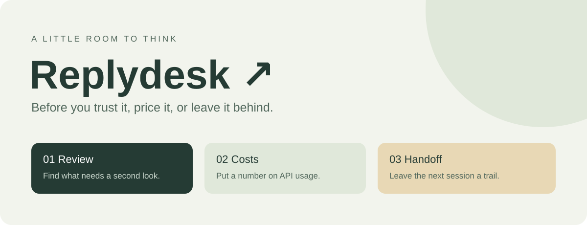
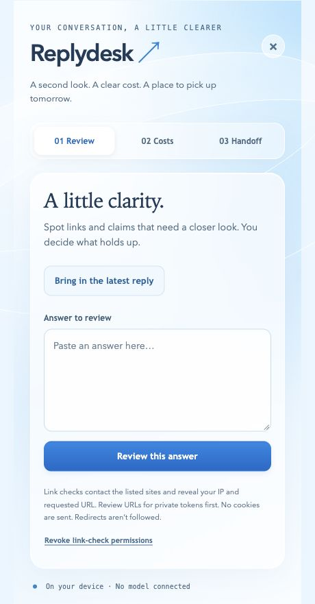

<p align="center"></p>

# Replydesk

A small desk beside your AI conversation. Review an answer, estimate API costs, and leave a useful checkpoint for the next coding session.

[](https://github.com/arhanali003/replydesk/actions/workflows/ci.yml)

**Early prototype · no AI service connected · no runtime dependencies**

Replydesk adds its own floating **···** button on ChatGPT. Click it to open three tools. You can also open the extension from the browser toolbar and paste text manually.

| Tool | What works | What it does not establish |
| --- | --- | --- |
| Review | Extract URLs, flag numerical/time-sensitive/source-dependent sentences, explicitly check HTTPS links | Whether a statement is true, whether a citation supports it, or whether every claim was found |
| Costs | Import normalized usage JSON and a configurable USD price table; export a report | Your actual invoice, current provider pricing, or ChatGPT subscription usage |
| Handoff | Export notes as SESSION.md; optionally import Git metadata from the Python CLI | That your notes are accurate or your tests passed |

## A look inside



The screenshot shows the local browser preview. The three tabs separate answer review, API cost estimates and session handoffs. No chat is sent to a model. Network link checks require an explicit click and browser permission.

## Help shape Replydesk

The repository is public and contributions are welcome. Pick an [open issue](https://github.com/arhanali003/replydesk/issues), describe your approach, and send a pull request. Start with the [contribution guide](CONTRIBUTING.md); it includes setup, tests and privacy boundaries. You do not need collaborator access to fork the repository or submit a PR.

## Install locally

1. Download this repository or `git clone https://github.com/arhanali003/replydesk.git`.
2. Open `chrome://extensions` in a Chromium browser and enable **Developer mode**.
3. Choose **Load unpacked**, then select the `extension` folder.
4. Reload ChatGPT. Open Replydesk’s floating button, or use its toolbar icon.

No build or API key is needed. This is an unpacked developer extension, not a Chrome Web Store release. Live ChatGPT capture and browser permission prompts still need manual compatibility testing; paste is the fallback if the page changes.

## Try it

**Review:** paste an answer and choose *Find review candidates*. Inspect the displayed URLs before choosing *Check listed HTTPS links*. The browser asks permission for those sites. Only the first 20 unique eligible links are checked. A successful HTTP response does not validate the answer. Restricted sites, unsupported HEAD requests, timeouts and redirects remain inconclusive.

**Costs:** load `examples/usage.json` and `examples/prices.json`, then estimate. The prices are fictional. Rates are decimal strings in USD per million tokens; `input_tokens` includes cached input. Unknown model prices are excluded from the priced subtotal and counted separately. This schema covers text input/output and cached input, not image/audio/tool fees, taxes, batch discounts or provider-specific billing rules.

**Handoff:** write the goal, decisions, checks actually run and next steps. To include a Git snapshot, use Python 3.9+ and Git:

```sh
python3 cli/checkpoint.py --repo /path/to/your/repo --format json --output checkpoint.json
# Import checkpoint.json in Handoff, then download SESSION.md.

# Or write Markdown directly, optionally including a notes file:
python3 cli/checkpoint.py --repo /path/to/your/repo --notes notes.txt --output SESSION.md
```

The CLI refuses to overwrite an existing output. It records HEAD and working-tree status, including filenames; it does not collect patches, source contents, ignored files or test results. Review filenames and notes before sharing. A snapshot is a point-in-time aid, not a backup.

## Privacy and limitations

Text, imports and notes stay in panel memory. Closing/reloading the panel can lose them: export anything you need. No telemetry, account, remote model or persistence is included.

Link checking is the deliberate network exception. It reveals your IP and the requested URL to the destination, including query parameters. Requests omit credentials and referrers and do not follow redirects. Host permissions persist until revoked. The panel offers a revoke button; ChatGPT integration permission remains enabled.

Public-looking HTTPS names only are accepted. This is a browser convenience filter, **not a DNS or network isolation boundary**: a hostname may resolve to an internal address. Do not check untrusted sensitive URLs. See [architecture and boundaries](docs/ARCHITECTURE.md).

## Develop and contribute

Requires Node.js 20+ and Python 3.9+; no package installation is needed.

```sh
npm test
npm run check
python3 -m http.server 8765
# Open http://localhost:8765/extension/panel.html for the local UI preview.
```

Network permissions and ChatGPT capture are unavailable in the plain web preview. Automated tests cover core logic and the CLI, not a real Chromium/ChatGPT session. See [CONTRIBUTING.md](CONTRIBUTING.md) for manual checks and small contribution ideas.

The next useful steps are a browser integration test suite, explicit provider-log adapters, and review-candidate heuristics beyond English. Improvements should stay honest about what was checked and what remains unknown.

## Why this exists

Long chats make it easy to lose the useful bits. A [SideProject discussion about navigating long AI conversations](https://www.reddit.com/r/SideProject/comments/1xalm1z/i_got_tired_of_scrolling_through_60_messages_in/) helped frame that problem. Combining review, cost inspection and handoff is our product hypothesis, not a validated demand claim. Replydesk is an independent implementation; it does not use that project’s code.

Built with AI coding assistance. Contributions are evaluated on their reasoning, tests and usefulness—not whether a tool helped write them. No affiliation with OpenAI or browser vendors.

[MIT license](LICENSE) · [Release notes](CHANGELOG.md) · [Security](SECURITY.md)
